<h1 align="center">Affine_Lab</h1>
<p align="center"><strong>Break a weak cipher. Reconstruct the packets. Verify every result.</strong></p>
<p align="center">A reproducible cryptanalysis lab with independent PCAP verification, an offline TCP replay and a local browser dashboard.</p>
<p align="center"><a href="https://www.python.org/"></a>
<a href="pyproject.toml"></a>
<a href="reports/evidence_verification.json"></a>
<a href="docs/ARCHITECTURE.md"></a>
<a href="src/affine_lab/analysis.py"></a>
<a href="LICENSE"></a>
<a href="src/affine_lab/web/index.html"></a>
<a href="assets/css/site.css"></a>
<a href="assets/js/site.js"></a>
<a href="Affine_Lab.code-workspace"></a></p>

## Live Links

| What | Link |
| --- | --- |
| Repository | [https://github.com/rohaan2802/Affine_Lab](https://github.com/rohaan2802/Affine_Lab) |
| GitHub Pages | [https://rohaan2802.github.io/Affine_Lab/](https://rohaan2802.github.io/Affine_Lab/) |
| Project resource | [https://github.com/maadilrehman/PsycoSupport](https://github.com/maadilrehman/PsycoSupport) |

## Contents

1. [Overview](#overview)
2. [What's Inside](#whats-inside)
3. [Project Breakdown](#project-breakdown)
4. [Folder Structure](#folder-structure)
5. [Setup](#setup)
6. [Demo](#demo)
7. [Results and Verification](#results-and-verification)
8. [Extended Analysis](#extended-analysis)
9. [Detailed Project Reference](#detailed-project-reference)
10. [Coursework Reports and Original Evidence](#coursework-reports-and-original-evidence)
11. [Visual Evidence](#visual-evidence)
12. [Limitations](#limitations)
13. [About the Author](#about-the-author)

## Overview

Affine_Lab demonstrates why a classical substitution cipher cannot secure a
conversation. Five synthetic concerns travel through a real loopback TCP client
and server. An independent analyzer receives the encrypted English reply, ranks
all **312 valid keys** by chi-square frequency fit and recovers the text.
Known inputs and the client's decryption are compared only after recovery.

The exercise evolved into an independently implemented, readable Python package.
It reconstructs the raw recorded packets without Wireshark, reproduces the local
exchange without internet, and offers an explicit fresh Gemini mode. The
coursework's supplied binary is not required or redistributed.

## What's Inside

| Area | What you can review |
| --- | --- |
| Maintained source | [Python package](src/affine_lab), [build metadata](pyproject.toml), [VS Code workspace](Affine_Lab.code-workspace) |
| Evidence | [Three distinct captures](data/recorded), five synthetic cases per capture, preserved SHA-256 provenance |
| Analysis | Histogram scoring, all 312 candidates, E/T congruences, Euclid/inverse proof, re-encryption checks |
| Demo | Offline real TCP replay; local HTML dashboard; optional Gemini HTTPS generation |
| Outputs | [Verified historical results](reports/evidence_verification.json), [new replay exports](reports/replay_demo) |
| Tests | [Correctness suite](tests), [browser verification tool](tools/check_browser.py), [figure/link checks](tools/check_portfolio.py) |
| Documentation | [Detailed project reference](docs/PROJECT_REFERENCE.md), [documentation index](docs/README.md), [demo and viva notes](docs/DEMO_GUIDE.txt), [architecture](docs/ARCHITECTURE.md), [data provenance](docs/DATA_PROVENANCE.md) |

## Project Breakdown

1. **Prepare input.** Username and concern become UTF-8 A–P nibble armor, then
   Affine ciphertext. The mood selects the lab key; credentials remain server-side.
2. **Exchange JSON.** A bounded IPv4 loopback server decodes the request and
   obtains either the exact saved reply or fresh text from the selected provider.
3. **Encrypt the reply.** English text is normalized to uppercase ASCII and
   returned through the deliberately weak local cipher.
4. **Recover independently.** The analyzer counts ciphertext letters once,
   permutes 26 frequency bins for each key and decrypts the lowest-scoring candidate.
   It does not consult mood or known plaintext during ranking.
5. **Verify.** Compare recovered key, mood, username, concern and reply; re-encrypt
   the result; for saved runs also compare reconstructed packet payloads and hashes.
6. **Export.** Save JSON, summary/ciphertext CSVs, readable proof/plaintext and
   a content manifest. Partial provider failures preserve completed cases as failures.

`C=(aP+b) mod 26`; `P=a⁻¹(C−b) mod 26`, with `gcd(a,26)=1`.
There are 12 multipliers × 26 shifts. Chi-square is
`Σ((observed−expected)²/expected)`, where expected counts use English frequencies.
For `(a,b)=(7,6)`, `a⁻¹=15`, because `7×15=4×26+1`.

## Folder Structure

```text
Affine_Lab/
├── src/affine_lab/          # maintained Python engine + packaged dashboard
│   ├── resources/          # normalized synthetic replay fixture
│   └── web/                # local dashboard HTML, CSS and JavaScript
├── data/recorded/           # three distinct raw captures and original records
├── reports/                # independently recomputed results and example exports
├── tests/                  # arithmetic, capture, TCP, provider and HTTP checks
├── tools/                  # evidence, figure, browser and portfolio verification
├── docs/                   # architecture, provenance, demo, archive and handoff
├── assets/                 # shared figures/previews, badges, CSS, JS, favicon
├── index.html              # responsive static portfolio + cipher playground
├── pyproject.toml          # runnable/installable package build configuration
└── Affine_Lab.code-workspace
```

Authored coursework reports, evidence and earlier source are included in the public project.
The complete supplied coursework archive is included under [archive/coursework](archive/coursework),
with third-party attribution. Actual credentials and generated environments remain excluded.
The curated dataset is small, so no duplicate release bundle is needed.

## Setup

Use **Python 3.12 or newer**. Runtime third-party dependencies: **zero**.

Windows PowerShell:

```powershell
py -3 -m venv .venv
.venv\Scripts\Activate.ps1
python -m pip install -e .
python -m affine_lab doctor
```

Ubuntu / WSL:

```bash
cd /mnt/c/Users/CodeTech/Desktop/Affine_Lab
python3 -m venv .venv-wsl
source .venv-wsl/bin/activate
python -m pip install -e .
```

Open `Affine_Lab.code-workspace` in VS Code. Select the matching interpreter.
Use **Terminal → Run Task** for named demo and verification tasks.
Windows and WSL require separate virtual environments. WSL is optional.

## Demo

```bash
python -m affine_lab verify data/recorded/tcp_baseline
python -m affine_lab inspect-pcap data/recorded/tcp_baseline/capture.pcap
python -m affine_lab demo
python -m affine_lab serve
```

Open `http://127.0.0.1:8765` for the local dashboard. Choose a synthetic case,
run real TCP replay, inspect the recovered reply/proof, and download exports.
The console prints each key and the new `runs/<timestamp>/` output directory.
Stop the server with Ctrl+C. The default mode uses recorded replies, with no API
request. Inspecting the saved corpus recomputes analysis without a TCP exchange.

For fresh Gemini generation, copy `.env.example` to `.env` and set your own
`GEMINI_API_KEY` locally. Then run:

```bash
python -m affine_lab demo --provider gemini
python -m affine_lab serve --provider gemini
```

The provider is selected at startup, not for every message. The configurable
default model is `gemini-3.5-flash-lite`; access and quotas depend on your account.
The key is excluded from Git. Gemini generates English text over a separate
HTTPS connection; the analyzer breaks the local Affine substitution, not TLS.
Failures never silently fall back to replay. Only synthetic demo inputs belong here.

The static [portfolio webpage](index.html) works without the Python server or API.
Its interactive cipher playground runs in the browser. GitHub Pages hosts this
presentation, while the TCP/API dashboard runs locally.

Optional new packet capture on Linux requires root and tcpdump:

```bash
sudo .venv-wsl/bin/python -m affine_lab demo --tcp-port 9999 --capture
```

Reading the included captures needs neither root nor tcpdump. A plain replay
does not create a packet capture unless `--capture` is requested.

## Results and Verification

The saved verification report records **3 captures, 15 sessions and 150 frames**.
All five keys in each capture were recovered and every known-input/payload/hash
comparison passed. A [fresh Gemini check](reports/fresh_gemini/result.json) also passed all five synthetic cases; its variable replies and actual execution time are saved separately. The independent replay run also passed five actual TCP
exchanges using recorded text.

| Case | Mood | Recovered a | Recovered b | Inverse |
| --- | --- | --- | --- | --- |
| 1 | 3 | 7 | 6 | 15 |
| 2 | 4 | 9 | 8 | 3 |
| 3 | 5 | 11 | 10 | 19 |
| 4 | 6 | 15 | 12 | 7 |
| 5 | 7 | 15 | 14 | 7 |

The seven-repeat local benchmark measured **11.770 ms** median for histogram
scoring versus **377.498 ms** for full-message scoring on one recorded reply.
All 312 candidate scores match the reference. This is a local measurement,
not a universal performance guarantee. Work changes from `O(312×N)` to
`O(N+312×26)` plus winning-text decryption.

```bash
python -m unittest discover -s tests -v
python tools/verify_evidence.py
python -m pip install -e ".[dev]"
python tools/build_portfolio.py
python tools/check_portfolio.py
python tools/check_browser.py
python -m pip wheel . --no-deps --wheel-dir dist
```

See [verification details](docs/VERIFICATION.md) for actual environments, browser
checks and the distinction between recorded evidence, new replay and live API checks.

## Extended Analysis

The maintained [CSV analyzer](src/affine_lab/batch.py) accepts a CSV with a
`ciphertext` column and exports every candidate score and letter-frequency row.
When a `field` column exists, it selects only `ciphertext` reply rows and skips
armored request fields, whose A–P distribution is not English prose.

```bash
python -m affine_lab analyze-csv data/recorded/tcp_baseline/ciphertexts.csv --output runs/batch
```

The [saved batch report](reports/batch_analysis/summary.csv) contains five recovered
keys, [1,560 candidate scores](reports/batch_analysis/candidate_ranking.csv) and
[130 frequency rows](reports/batch_analysis/letter_frequencies.csv). Arbitrary CSV
results remain explicitly unverified until compared with independent known inputs.
Input size/row/character limits and nonempty-output protection keep this workflow
bounded. See [CSV format and exports](docs/CSV_WORKFLOW.md).

The browser playground now shows the top five candidate keys and a measured
frequency comparison chart, with copy/download controls for the computed result.
It works from the static page, without sending your entered text to a provider.

### A short recruiter walkthrough

1. Open the webpage and recover the supplied full-length ciphertext sample.
2. Inspect candidate scores and letter frequencies, then download the analysis.
3. Run the Python replay or CSV command and compare its recovered keys.
4. Open the readable [analyzer](src/affine_lab/analysis.py),
   [CSV workflow](src/affine_lab/batch.py) and [build file](pyproject.toml).
5. Follow the raw capture, recovery proof and independently checked saved outputs.

## Detailed Project Reference

A complete view of the actual inputs, execution boundaries, maintained source and saved evidence.

### Problem, scope and engineering goals

The project asks a concrete question: can an observer recover a conversation protected by an Affine substitution cipher without receiving its key? The independent analyzer ranks candidate keys from the encrypted English reply; a separate verifier then checks the result against known synthetic inputs.

The engineering goal is to make that claim inspectable from end to end: readable source, real local TCP traffic, original packet bytes, explicit provider modes, worked recovery proofs and portable output files. The portfolio extends the original coursework with an independent Python implementation rather than relying on the supplied executable.

The public demonstration uses invented concerns. It is an educational cryptanalysis exercise, not a clinical application, a secure messaging product or a tool for decrypting HTTPS.

### Inputs and the five demonstration cases

Each case has a stable case ID, a synthetic username, a mood from 1 to 10 and a concern string. The baseline fixture also stores the exact English reply required for deterministic replay. Input case selection and ciphertext recovery are separate operations.

The five examples below are the actual packaged cases, not additional invented results. Reusing the same inputs across historical captures, replay and fresh API generation makes key/input comparisons meaningful while allowing model text to vary.

| Case | Mood | Username | Synthetic concern |
| --- | --- | --- | --- |
| 1 | 3 | Rohaan | My final exams start next week and I cannot sleep because I keep thinking I will fail. |
| 2 | 4 | Rohaan | I moved to a new city for university and I have not made any friends yet, the weekends feel very empty. |
| 3 | 5 | Rohaan | I am working part time and studying full time, and I feel tired all the time and fall behind on assignments. |
| 4 | 6 | Rohaan | I had a big argument with my older brother and now we are not talking, and it is bothering me every day. |
| 5 | 7 | Rohaan | My final year project deadline is close, my group members are not replying, and I feel like I have to do everything alone. |

### Execution modes and what each one proves

Choose the mode according to the claim being demonstrated. Recomputing saved evidence, exchanging new TCP messages and generating a new model reply are different activities; the interface and exported JSON label them separately.

Provider selection happens when starting the local server or CLI demo. Gemini produces English text; it does not recover the cipher key. A failed Gemini request does not silently switch the experiment to recorded replies.

| Workflow | Input / reply source | New local TCP? | External API? | Result |
| --- | --- | --- | --- | --- |
| Static playground | Typed text or recorded ciphertext sample | No | No | Candidate keys, frequencies and downloadable JSON |
| Recorded verification | Preserved PCAP bytes and original requests/replies | No | No | Independent payload/hash/input comparisons |
| Dashboard corpus inspection | Packaged baseline replies | No | No | Recomputed analysis, explicitly labelled saved corpus |
| Offline replay | Known synthetic inputs and exact saved replies | Yes | No | New loopback exchange, recovery and run exports |
| Fresh Gemini | Known synthetic inputs and newly generated English | Yes | Yes, HTTPS | New generation and local cipher checks |
| CSV analysis | Selected English-reply rows from a CSV | No | No | Complete rankings and frequency tables; heuristic candidates |

### Message lifecycle and wire-field contract

The client first converts username and concern to UTF-8 bytes. Each byte becomes two A–P nibble letters, after which Affine substitution encrypts the armored string. The server reverses those two steps, obtains a reply, cleans it to uppercase ASCII letters/spaces and encrypts it for the local return path.

The client can decrypt using its known key. Independently, the analyzer sees the reply ciphertext and ranks all 312 valid keys. Mood and known plaintext are consulted by verification only after that ranking.

The local TCP connection and the optional Gemini HTTPS connection are separate transports. Capturing the lab port exposes deliberately weak Affine traffic; it does not expose the API key or decrypt TLS.

| Direction / field | Representation | Validation / role |
| --- | --- | --- |
| Request: username_enc | Affine-encrypted A–P UTF-8 armor | Decoded username must contain 1–100 characters |
| Request: mood | Integer from 1 to 10 | Selects the recorded lab key schedule |
| Request: message_enc | Affine-encrypted A–P UTF-8 armor | Decoded concern must contain 1–2,000 characters |
| Request: api_key_enc | Empty string | Nonempty credentials in this local protocol are rejected |
| Reply: ciphertext | Affine-encrypted uppercase English | Analyzed independently; normal client decryption is compared afterwards |
| Failure: error | A bounded JSON error response | Provider failures remain explicit; no replay fallback |

### Recovery mathematics and measured efficiency

Represent letters as A=0 through Z=25. Encryption is C=(aP+b) mod 26. Decryption is P=a⁻¹(C−b) mod 26, where a must be coprime to 26. Twelve valid multipliers and 26 shifts give 312 candidates.

For each candidate, expected letter counts equal the total ASCII-letter count multiplied by the English reference percentage. The chi-square score sums (observed−expected)²/expected across the alphabet. Lower scores indicate a closer language fit, not a probability of correctness.

For the recovered example a=7, b=6, the inverse is 15 because 7×15=105=4×26+1. Under that candidate E maps to I and T to J. Subtracting 4a+b=8 from 19a+b=9 yields 15a=1 mod 26, which gives a=7 and b=6. These correspondences explain the winning candidate rather than assuming the two most common letters are always E and T.

The optimized scorer counts the ciphertext once and permutes 26 bins per key: O(N+312×26), followed by winning-text decryption. A full-text reference instead performs O(312×N) work. Complete-score parity is tested; CSV export reuses one ranking rather than scoring the same message twice.

On the saved local benchmark, the histogram scorer measured 11.770 ms median versus 377.498 ms for the full-text reference, over 7 repetitions and 689 letters. These are machine/input-specific measurements, not a universal speed claim.

### Maintained source modules and responsibilities

The package separates arithmetic, transport, model access, recovery and post-recovery checks. This keeps the attack independent of the mood schedule and lets the same analysis engine serve CLI, CSV and local dashboard workflows.

| Module | Responsibility | Review focus |
| --- | --- | --- |
| [crypto.py](src/affine_lab/crypto.py) | Validated keys, substitution, inverses and UTF-8 armor | All valid-key round trips and invalid inputs |
| [analysis.py](src/affine_lab/analysis.py) | Histogram scoring, ranking, plaintext and worked proof | No mood-schedule input; reference-score parity |
| [capture.py](src/affine_lab/capture.py) | Classic PCAP parsing and loopback TCP reconstruction | Bounds, sequence gaps, overlaps and conflicting retransmissions |
| [protocol.py](src/affine_lab/protocol.py) | Bounded JSON/TCP client and server | Actual local exchange and request validation |
| [providers.py](src/affine_lab/providers.py) | Exact replay or explicit Gemini HTTPS generation | Server-side credentials and no silent fallback |
| [validation.py](src/affine_lab/validation.py) | Separate known-input, client and capture comparisons | Recovery first, independent checks afterwards |
| [runner.py](src/affine_lab/runner.py) | Case orchestration and partial-failure reporting | Completed results survive a later failure |
| [reporting.py](src/affine_lab/reporting.py) | JSON/CSV/proof/plaintext and integrity manifests | Portable outputs and nonempty-directory protection |
| [batch.py](src/affine_lab/batch.py) | Reply CSV selection and all-candidate exports | Armored fields skipped; heuristic output labelled |
| [web.py](src/affine_lab/web.py) | Local dashboard routes and export allowlist | Loopback binding, same-origin controls and private paths |
| [cli.py](src/affine_lab/cli.py) | Runnable commands and optional Linux capture | Clear command results and output locations |
| [pyproject.toml](pyproject.toml) | Package metadata, entry point and bundled resources | Zero runtime dependencies; wheel build |
| [VS Code workspace](Affine_Lab.code-workspace) | Editor entry point and matching interpreter setup | Portable demo/test tasks |

### Saved outputs and how to inspect them

New demo runs save to ignored timestamped runs directories. Reviewed examples under reports are maintained evidence. A run records its provider, generation label, execution time, requested/completed cases and overall pass/fail state.

A SHA-256 manifest detects changes relative to a trusted saved manifest. It is integrity metadata rather than a digital signature. Capture files exist only for runs explicitly executed with packet capture.

| Output | Contents | Use in review |
| --- | --- | --- |
| [Replay result JSON](reports/replay_demo/result.json) | Requests, replies, recovered text, proofs and individual checks | Trace a single case from wire fields to verification |
| [Replay summary CSV](reports/replay_demo/summary.csv) | Case, mood, a, b, inverse, score and verified flag | Compare the five recovered keys |
| [Recovery proof](reports/replay_demo/key_recovery_proof.txt) | Congruence equations and inverse reasoning | Explain the mathematics without reading JSON |
| [Decrypted sessions](reports/replay_demo/decrypted_sessions.txt) | Recovered username, concern and English reply | Inspect complete readable output |
| [Captured replay](reports/replay_demo/capture.pcap) | New WSL loopback packet bytes from the maintained implementation | Independently reconstruct requests and replies |
| [Fresh Gemini result](reports/fresh_gemini/result.json) | Separately recorded real API generation and local checks | Distinguish fresh model text from replay |
| [CSV candidate rankings](reports/batch_analysis/candidate_ranking.csv) | 1,560 scored candidates for five baseline replies | Inspect alternatives rather than only the winning key |
| [CSV letter frequencies](reports/batch_analysis/letter_frequencies.csv) | 130 measured/reference rows across five replies | Recreate per-letter comparisons |

### Evidence strength and interpretation

Three historical PCAPs contain 15 sessions and 150 frames in total. Each historical session is checked against its raw reconstructed payloads, capture digest, recovered key, decoded inputs, client reply and re-encryption. The maintained replay also has a separately captured 50-frame run.

The local correctness suite has 38 tests on Windows and Ubuntu/WSL. Browser checks cover desktop, tablet and narrow-mobile layouts in both themes, gallery controls, file-based presentation, copy/download controls and JavaScript/Python arithmetic parity for all 312 keys.

The separate fresh Gemini example passed five synthetic cases at its recorded execution time. Future quota/model access and generated content can vary. An arbitrary CSV import or a short browser sample is still a language-fit candidate unless independently verified.

Short text, unusual vocabulary and non-English prose can produce a wrong best candidate. Re-encryption alone cannot establish correctness, because any invertible candidate can transform its own decryption back into the same ciphertext.

### Setup, troubleshooting and reproducibility

Use Python 3.12 or newer, create an environment for your operating system and install the local package. Windows and WSL environments are separate. The default replay and saved capture reader need no third-party runtime packages; figure/browser tools use optional development dependencies.

The static portfolio can open directly from index.html. The local Python dashboard starts separately at 127.0.0.1:8765 and is stopped with Ctrl+C. Neither the static site nor GitHub Pages hosts the TCP server or stores an API key.

| Symptom | Likely cause | Action |
| --- | --- | --- |
| No module named affine_lab | Wrong interpreter or package not installed | Activate the intended environment and run python -m pip install -e . |
| Dashboard port already in use | Another local server is running | Stop that server or select --http-port / --tcp-port |
| CSV needs a ciphertext column | Header does not match the input contract | Use a UTF-8 CSV with ciphertext; inspect docs/CSV_WORKFLOW.md |
| Output directory is not empty | Existing reviewed output is protected | Choose a new output directory rather than overwriting evidence |
| Gemini key missing / quota error | Credentials, account quota or model availability | Check local configuration privately or explicitly restart in replay mode |
| Live capture unavailable on Windows | Optional tcpdump path requires Linux root | Read saved captures without elevation, or use WSL for new capture |

```bash
python -m affine_lab verify data/recorded/tcp_baseline
python -m affine_lab demo
python -m affine_lab analyze-csv data/recorded/tcp_baseline/ciphertexts.csv --output runs/batch
python -m unittest discover -s tests -v
python tools/check_portfolio.py
python tools/check_publish.py
```

## Coursework Reports and Original Evidence

The authored [assignment PDF](docs/reports/assignment_report.pdf) and
[pre-demo PDF](docs/reports/pre_demo_report.pdf) are included in the public
repository, alongside their [HTML views](docs/reports/README.md),
[17 desktop screenshot files](evidence/coursework/index.html),
[historical authored source](legacy/coursework/README_HISTORY.md) and
[saved coursework outputs](reports/coursework).

The coursework screenshots use the existing edited taskbar display date
22 October 2026. Their actual capture timestamps remain 18–19 November 2026 in
raw PCAPs/logs. These are presentation copies, separate from the 24 generated
portfolio figures. The PDFs contain the same six/eleven edited screenshots;
see the [evidence manifest](evidence/coursework/manifest.json).

## Visual Evidence

24 figures share the same images, captions and order with the webpage.
The webpage offers a **Larger previews** control for bigger desktop/tablet cards;
narrow-mobile previews already use the available single-column width.
Click a left-aligned preview to open its full 1440 × 900 image. Previews are
960 × 600. The gallery groups design, inputs, method, analysis, evidence,
results, source, demo and verification material.

1. [From conversation to recovered plaintext](#figure-01)
2. [Three distinct recorded runs](#figure-02)
3. [The five synthetic input cases](#figure-03)
4. [Mood keys and modular inverses](#figure-04)
5. [A worked recovery proof](#figure-05)
6. [Case 1 — recovered letter profile](#figure-06)
7. [Case 2 — recovered letter profile](#figure-07)
8. [Case 3 — recovered letter profile](#figure-08)
9. [Case 4 — recovered letter profile](#figure-09)
10. [Case 5 — recovered letter profile](#figure-10)
11. [Recovered text from every case](#figure-11)
12. [Ranking the strongest candidates](#figure-12)
13. [Winning scores versus the runners-up](#figure-13)
14. [The substitution alphabet](#figure-14)
15. [UTF-8 armor is reversible encoding](#figure-15)
16. [Actual recorded JSON fields](#figure-16)
17. [Independent PCAP reconstruction](#figure-17)
18. [Fifteen independent recovery checks](#figure-18)
19. [A new real TCP replay run](#figure-19)
20. [Readable maintained cipher source](#figure-20)
21. [Score 26 bins instead of whole messages](#figure-21)
22. [The local browser dashboard](#figure-22)
23. [Portable exports with integrity hashes](#figure-23)
24. [Correctness and measured efficiency](#figure-24)

<a id="figure-01"></a>

### Figure 01 — From conversation to recovered plaintext

[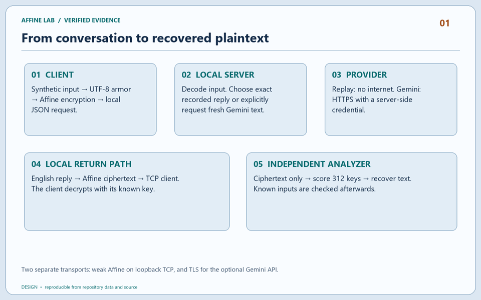](assets/figures/full/01-from-conversation-to-recovered-plaintext-v3.png)

Two separate transports: weak Affine on loopback TCP, and TLS for the optional Gemini API.

<a id="figure-02"></a>

### Figure 02 — Three distinct recorded runs

[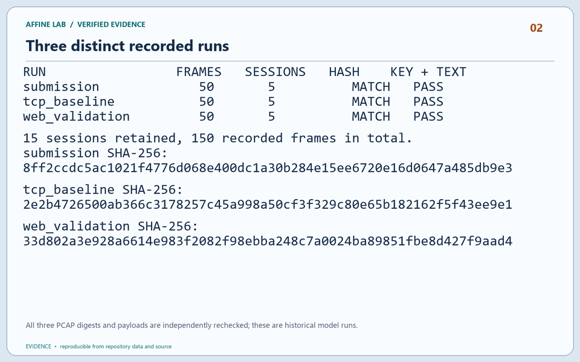](assets/figures/full/02-three-distinct-recorded-runs-v3.png)

All three PCAP digests and payloads are independently rechecked; these are historical model runs.

<a id="figure-03"></a>

### Figure 03 — The five synthetic input cases

[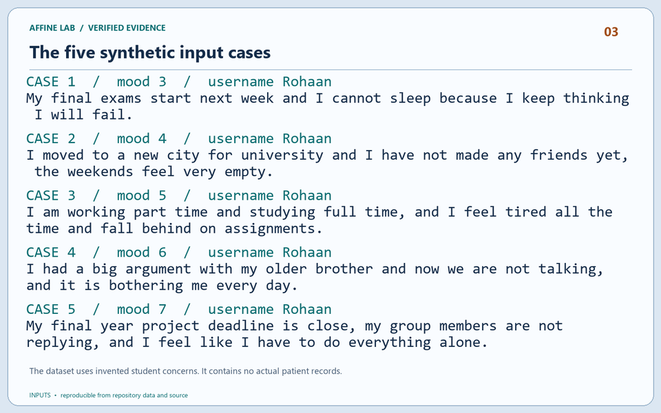](assets/figures/full/03-the-five-synthetic-input-cases-v3.png)

The dataset uses invented student concerns. It contains no actual patient records.

<a id="figure-04"></a>

### Figure 04 — Mood keys and modular inverses

[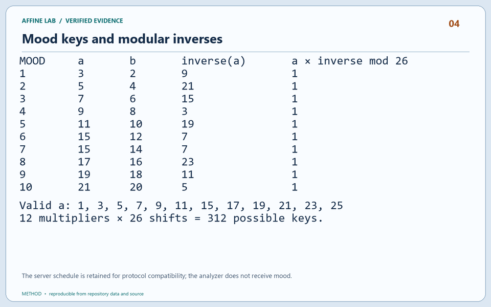](assets/figures/full/04-mood-keys-and-modular-inverses-v3.png)

The server schedule is retained for protocol compatibility; the analyzer does not receive mood.

<a id="figure-05"></a>

### Figure 05 — A worked recovery proof

[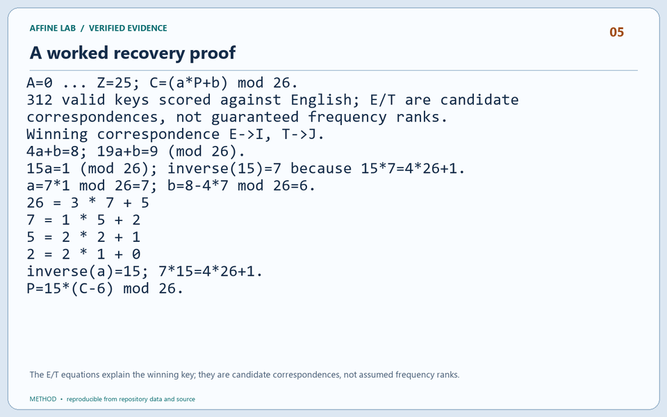](assets/figures/full/05-a-worked-recovery-proof-v3.png)

The E/T equations explain the winning key; they are candidate correspondences, not assumed frequency ranks.

<a id="figure-06"></a>

### Figure 06 — Case 1 — recovered letter profile

[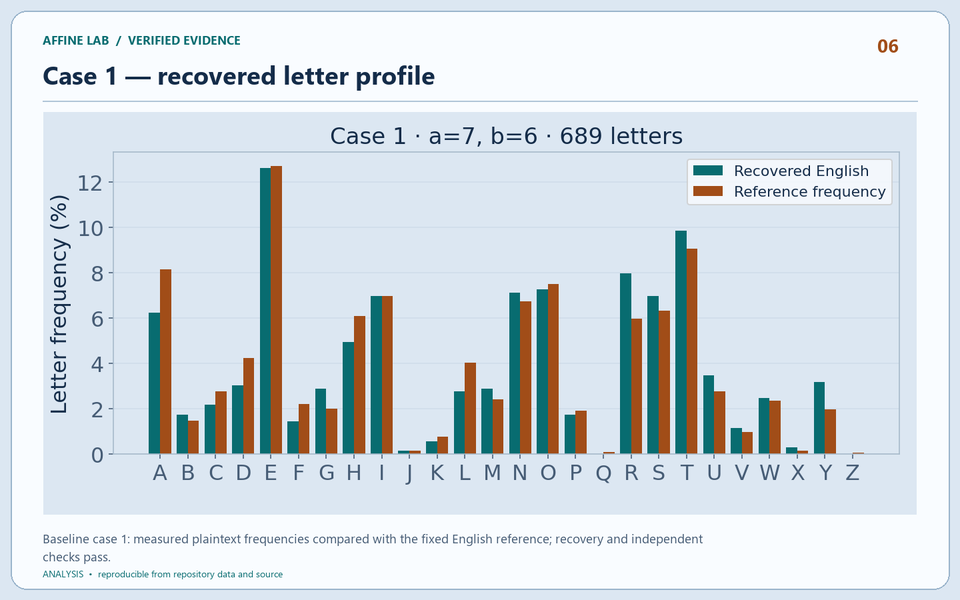](assets/figures/full/06-case-1---recovered-letter-profile-v3.png)

Baseline case 1: measured plaintext frequencies compared with the fixed English reference; recovery and independent checks pass.

<a id="figure-07"></a>

### Figure 07 — Case 2 — recovered letter profile

[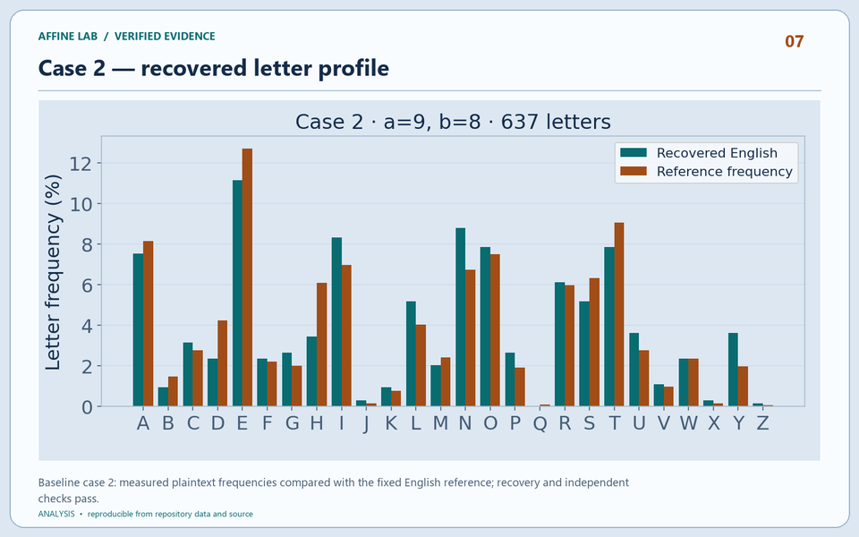](assets/figures/full/07-case-2---recovered-letter-profile-v3.png)

Baseline case 2: measured plaintext frequencies compared with the fixed English reference; recovery and independent checks pass.

<a id="figure-08"></a>

### Figure 08 — Case 3 — recovered letter profile

[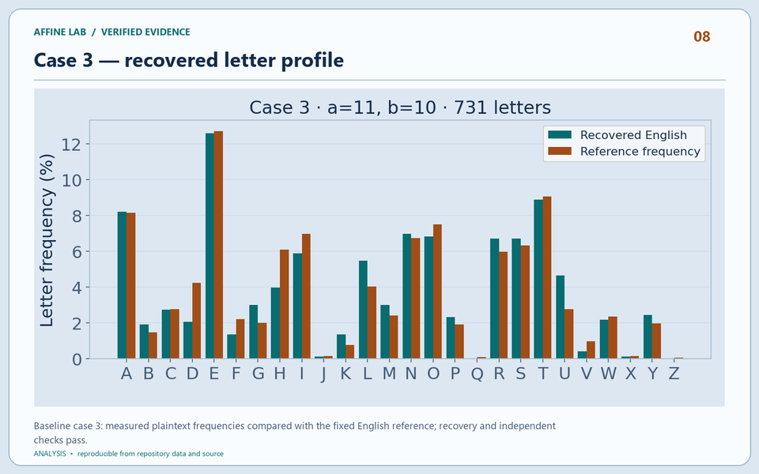](assets/figures/full/08-case-3---recovered-letter-profile-v3.png)

Baseline case 3: measured plaintext frequencies compared with the fixed English reference; recovery and independent checks pass.

<a id="figure-09"></a>

### Figure 09 — Case 4 — recovered letter profile

[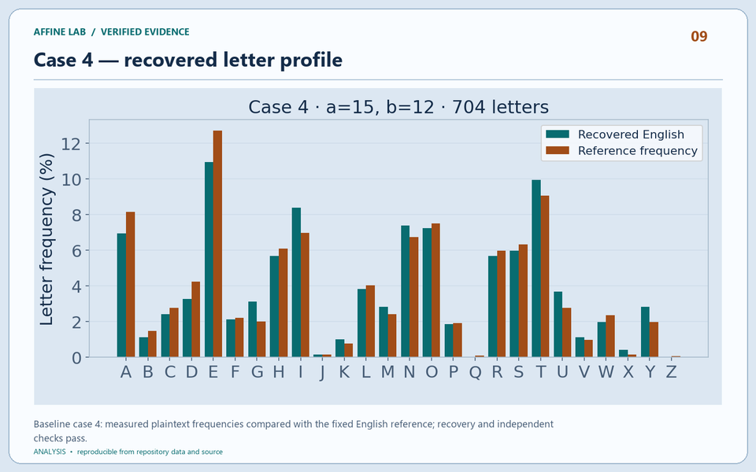](assets/figures/full/09-case-4---recovered-letter-profile-v3.png)

Baseline case 4: measured plaintext frequencies compared with the fixed English reference; recovery and independent checks pass.

<a id="figure-10"></a>

### Figure 10 — Case 5 — recovered letter profile

[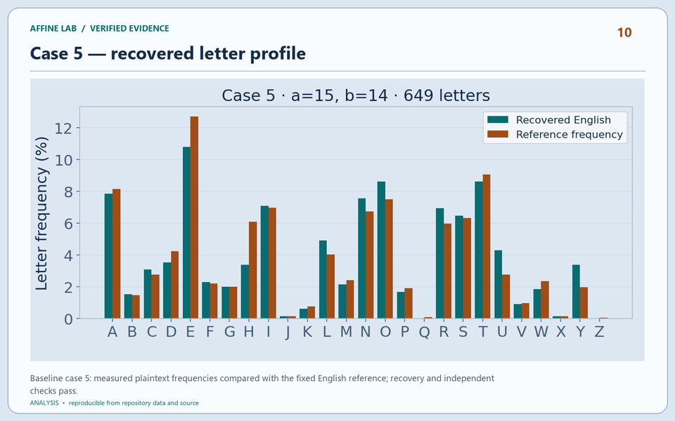](assets/figures/full/10-case-5---recovered-letter-profile-v3.png)

Baseline case 5: measured plaintext frequencies compared with the fixed English reference; recovery and independent checks pass.

<a id="figure-11"></a>

### Figure 11 — Recovered text from every case

[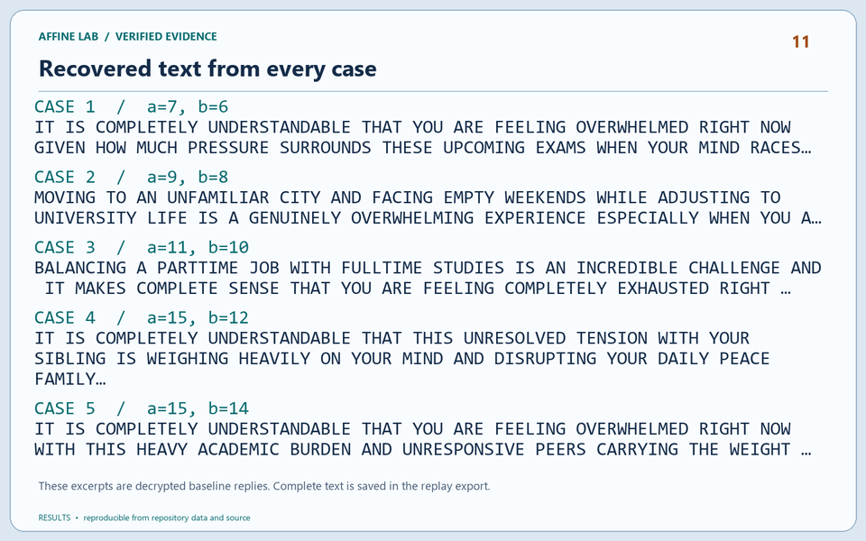](assets/figures/full/11-recovered-text-from-every-case-v3.png)

These excerpts are decrypted baseline replies. Complete text is saved in the replay export.

<a id="figure-12"></a>

### Figure 12 — Ranking the strongest candidates

[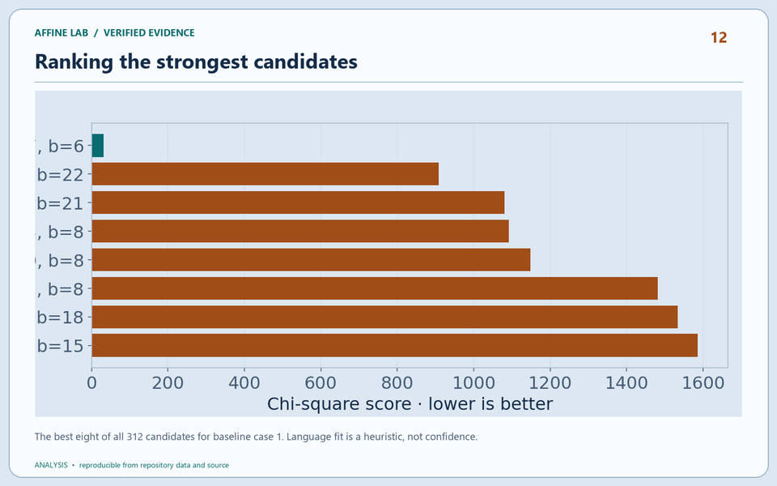](assets/figures/full/12-ranking-the-strongest-candidates-v3.png)

The best eight of all 312 candidates for baseline case 1. Language fit is a heuristic, not confidence.

<a id="figure-13"></a>

### Figure 13 — Winning scores versus the runners-up

[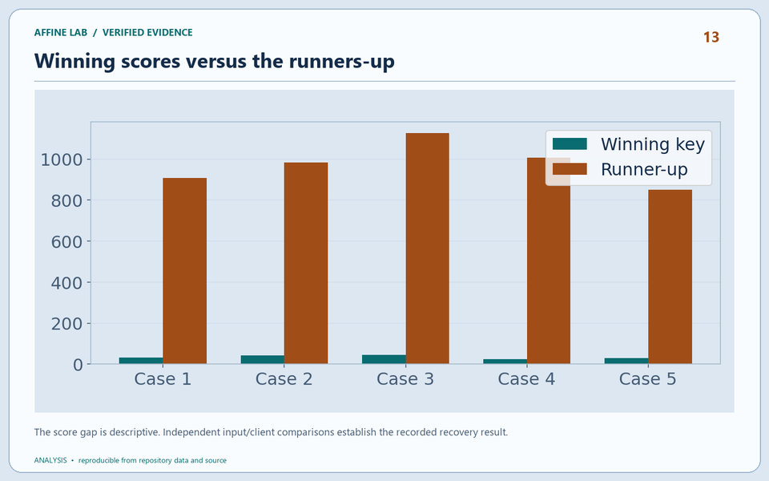](assets/figures/full/13-winning-scores-versus-the-runners-up-v3.png)

The score gap is descriptive. Independent input/client comparisons establish the recorded recovery result.

<a id="figure-14"></a>

### Figure 14 — The substitution alphabet

[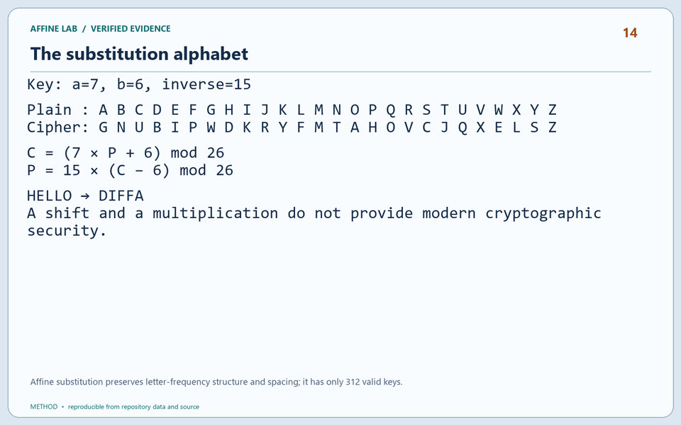](assets/figures/full/14-the-substitution-alphabet-v3.png)

Affine substitution preserves letter-frequency structure and spacing; it has only 312 valid keys.

<a id="figure-15"></a>

### Figure 15 — UTF-8 armor is reversible encoding

[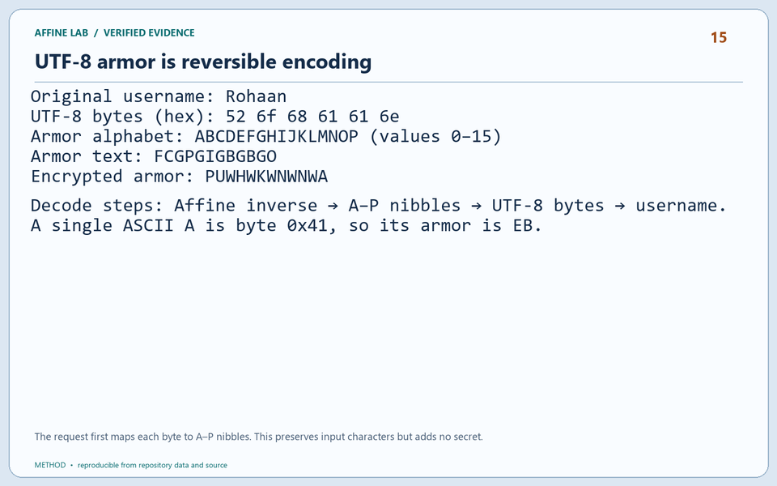](assets/figures/full/15-utf-8-armor-is-reversible-encoding-v3.png)

The request first maps each byte to A–P nibbles. This preserves input characters but adds no secret.

<a id="figure-16"></a>

### Figure 16 — Actual recorded JSON fields

[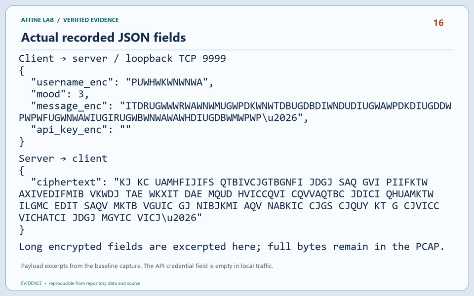](assets/figures/full/16-actual-recorded-json-fields-v3.png)

Payload excerpts from the baseline capture. The API credential field is empty in local traffic.

<a id="figure-17"></a>

### Figure 17 — Independent PCAP reconstruction

[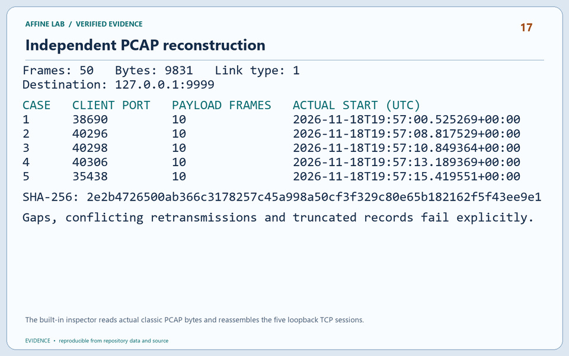](assets/figures/full/17-independent-pcap-reconstruction-v3.png)

The built-in inspector reads actual classic PCAP bytes and reassembles the five loopback TCP sessions.

<a id="figure-18"></a>

### Figure 18 — Fifteen independent recovery checks

[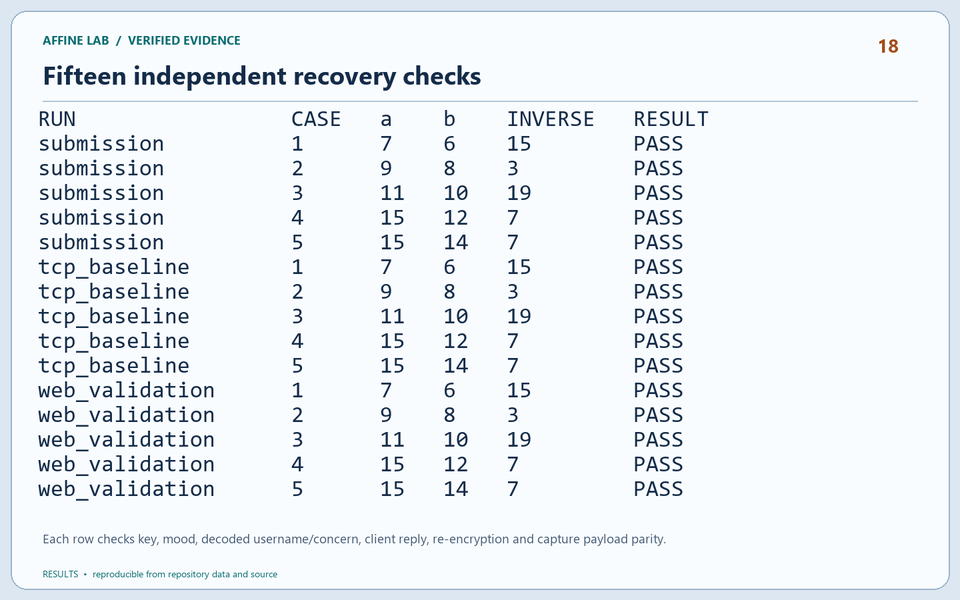](assets/figures/full/18-fifteen-independent-recovery-checks-v3.png)

Each row checks key, mood, decoded username/concern, client reply, re-encryption and capture payload parity.

<a id="figure-19"></a>

### Figure 19 — A new real TCP replay run

[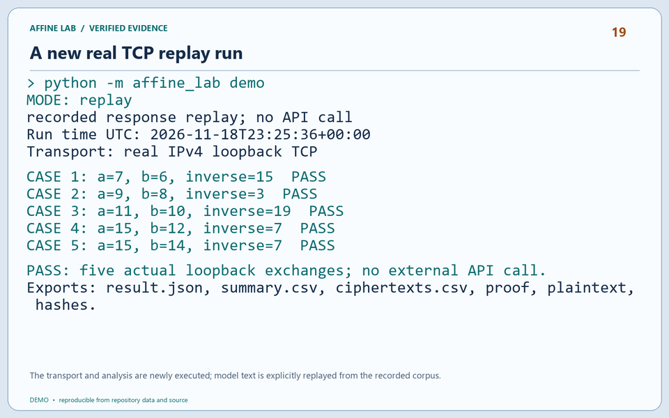](assets/figures/full/19-a-new-real-tcp-replay-run-v3.png)

The transport and analysis are newly executed; model text is explicitly replayed from the recorded corpus.

<a id="figure-20"></a>

### Figure 20 — Readable maintained cipher source

[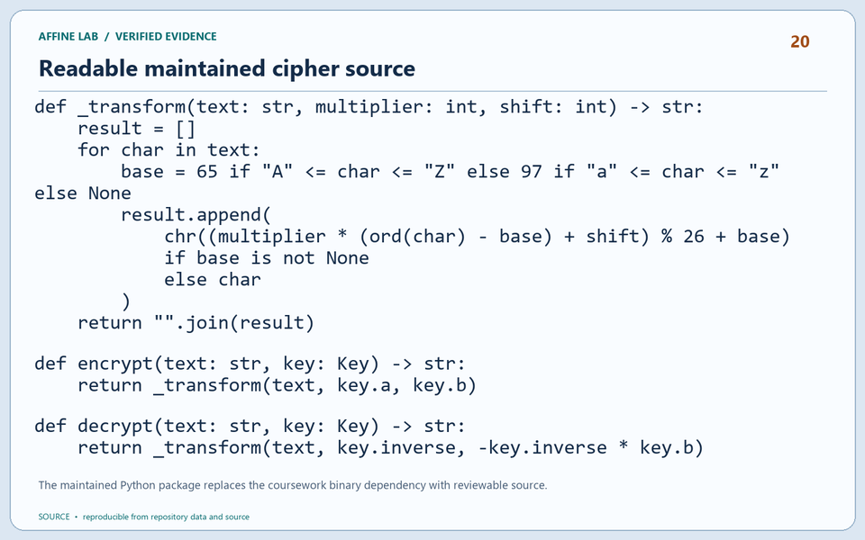](assets/figures/full/20-readable-maintained-cipher-source-v3.png)

The maintained Python package replaces the coursework binary dependency with reviewable source.

<a id="figure-21"></a>

### Figure 21 — Score 26 bins instead of whole messages

[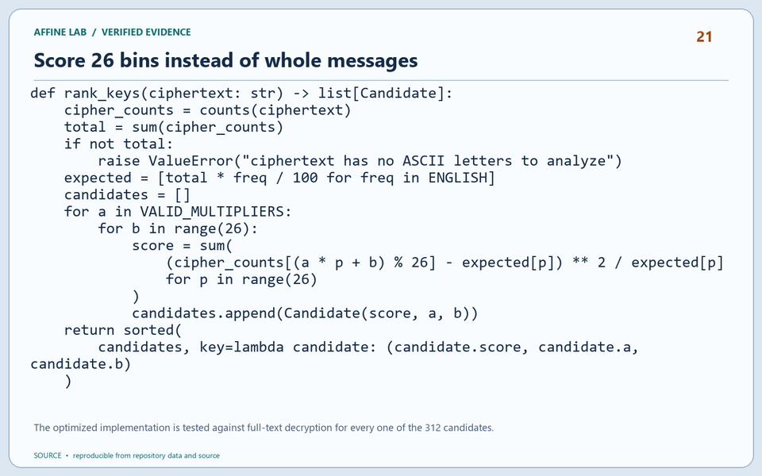](assets/figures/full/21-score-26-bins-instead-of-whole-messages-v3.png)

The optimized implementation is tested against full-text decryption for every one of the 312 candidates.

<a id="figure-22"></a>

### Figure 22 — The local browser dashboard

[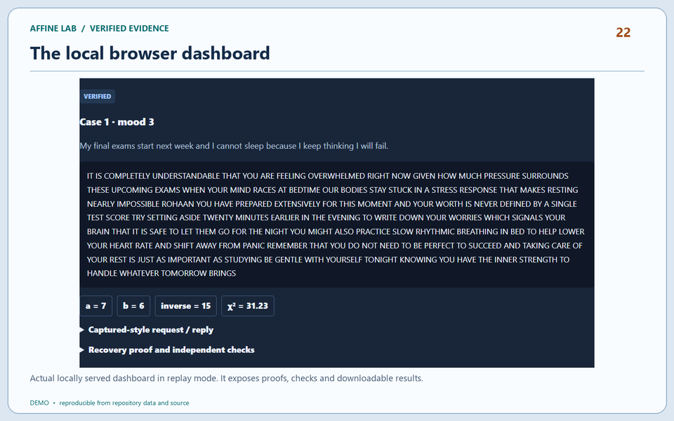](assets/figures/full/22-the-local-browser-dashboard-v3.png)

Actual locally served dashboard in replay mode. It exposes proofs, checks and downloadable results.

<a id="figure-23"></a>

### Figure 23 — Portable exports with integrity hashes

[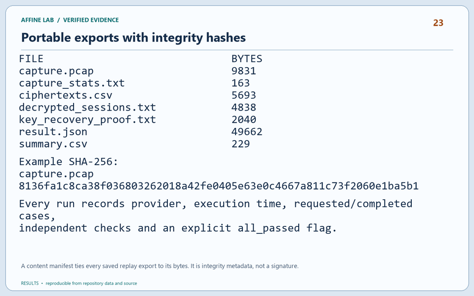](assets/figures/full/23-portable-exports-with-integrity-hashes-v3.png)

A content manifest ties every saved replay export to its bytes. It is integrity metadata, not a signature.

<a id="figure-24"></a>

### Figure 24 — Correctness and measured efficiency

[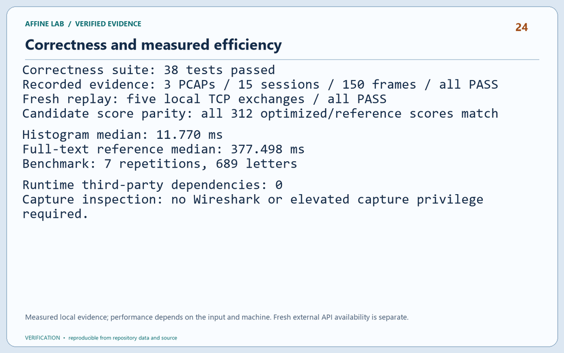](assets/figures/full/24-correctness-and-measured-efficiency-v3.png)

Measured local evidence; performance depends on the input and machine. Fresh external API availability is separate.

## Limitations

Frequency fit can choose a wrong key for short, unusual or non-English text.
Scores are not probabilities; E/T correspondences describe a candidate rather
than guaranteed frequency ranks. Synthetic model replies are not clinical advice.
The local server is a bounded teaching demo, not a production service.
The capture inspector supports this lab's classic PCAP/IPv4/TCP traffic and
rejects unsupported/incomplete streams; it is not a general Wireshark replacement.
No TLS decryption or security claim for Affine encryption is made.

See [security reflection](docs/SECURITY_REFLECTION.md), [architecture and limits](docs/ARCHITECTURE.md), [data provenance](docs/DATA_PROVENANCE.md)
and [license](LICENSE). Fresh Gemini behavior can vary and requires your own account.

## About the Author

**Mohammad Rohaan** · Computer Science, FAST-NUCES

[GitHub](https://github.com/rohaan2802) · [Email](mailto:m.rohaanarshad@gmail.com)

Built to make packet evidence, classical cryptanalysis and reproducible
verification easy to inspect in one runnable project.
